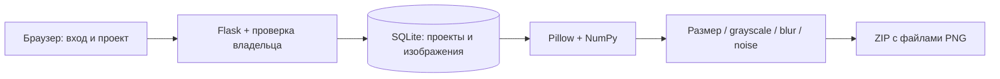

# NeuralNetwork Builder

**Локальный менеджер изображений и аугментаций для подготовки датасетов.**

Регистрация, отдельные проекты, загрузка изображений, просмотр, статистика и
ZIP-экспорт с изменением размера, оттенками серого, размытием и шумом.
Историческое название сохранено: создание и обучение нейросетей в этой версии
**не реализованы** — соответствующий раздел интерфейса остаётся экспериментальным.

[Запуск](#запуск) · [Работа с датасетом](#работа-с-датасетом) · [Компоненты](#компоненты) · [Проверка](#проверка) · [Ограничения](#ограничения)

## Возможности

| Действие | Результат |
|---|---|
| Создать проект | Отдельный набор изображений текущего пользователя |
| Загрузить изображения | Сервер проверяет всю партию и сохраняет нормализованные PNG |
| Открыть Dataset | Предпросмотр первых 100 изображений и отдельного кадра |
| Открыть Statistic | Количество изображений в проекте |
| Generate/Download | ZIP с PNG выбранного размера и необязательными аугментациями |
| Удалить кадр | POST-форма с CSRF-проверкой; открытие ссылки ничего не удаляет |



## Запуск

Проверенная среда: **Windows, Python 3.14.7**. Прямые зависимости: Flask,
Flask-Login, Flask-WTF, WTForms, SQLAlchemy, Pillow и NumPy. Нейросетевые
фреймворки, GPU и камера для существующего менеджера датасетов не нужны.

```powershell
git clone https://github.com/MrRodikolion/NeuralNetwork_builder.git
cd NeuralNetwork_builder
python -m venv venv
.\venv\Scripts\python.exe -m pip install Flask==3.1.3 Flask-Login==0.6.3 Flask-WTF==1.3.0 WTForms==3.3.2 SQLAlchemy==2.1.8 Pillow==13.0.0 numpy==2.5.4
.\venv\Scripts\python.exe app.py
```

Откройте [http://localhost:8080](http://localhost:8080). На Linux/macOS вместо
`venv\Scripts\python.exe` используется `venv/bin/python`; эти платформы отдельно
не проверялись. При первом запуске автоматически создаются `db/database.sqlite`
и таблицы. Путь привязан к `app.py`, поэтому запуск по абсолютному пути также
использует базу проекта, а не случайный рабочий каталог.

Существующая команда запуска слушает `0.0.0.0:8080`; приложение предназначено
для локальных учебных данных и не подготовлено для публикации в интернете.
Для оформления используются внешние Bootstrap/Font Awesome CDN; без сети
интерфейс может отображаться без части стилей и значков.

## Работа с датасетом

1. Откройте **Sign-in**, зарегистрируйте учебную учётную запись, затем войдите
   через **Log-in**. Не используйте реальные пароли или чувствительные данные.
2. Перейдите в раздел проектов датасетов `/app/projects/db` и создайте проект.
   Имя пользователя и проекта не должно содержать `/`, `?` или `#`.
3. На вкладке **Upload data** выберите изображения или перетащите их в область
   загрузки и нажмите **Upload**. Можно выбрать несколько файлов.
4. **Dataset** показывает первые 100 изображений; **Statistic** — общее количество.
5. На **Download** задайте ширину и высоту от **1 до 4096** пикселей и выберите
   нужные дополнительные варианты. В ZIP всегда включается исходный вариант,
   приведённый к выбранному размеру.

Пример экспорта одного изображения со всеми опциями:

```text
project.zip
  0.png       изменённый размер
  0_g.png     оттенки серого
  0_b.png     Gaussian blur, radius=4
  0_n.png     случайный шум
```

Расширение `.png` соответствует реальному формату данных. Имена — порядковые
номера изображений в проекте на момент экспорта. Объектной разметки, train/val
разбиения и обучения модели этот ZIP не содержит.

## Компоненты

| Путь | Назначение |
|---|---|
| [app.py](app.py) | Маршруты, формы, проверка владельца, загрузка и ZIP-экспорт |
| [data/db_session.py](data/db_session.py) | SQLite и сессии SQLAlchemy с закрытием после запроса |
| [data/db_projects.py](data/db_projects.py) | Существующая модель проекта и изображений |
| [data/users.py](data/users.py) | Существующая учебная модель пользователя |
| [api/images_api.py](api/images_api.py) | Предпросмотр первого кадра или изображения-заглушки |
| [forms/](forms/) | Валидация пользовательского ввода |
| [templates/](templates/) | Страницы интерфейса |
| [static/js/project.js](static/js/project.js) | Перетаскивание файлов и локальные предпросмотры |

Пути чтения сохранены. Закрытые маршруты требуют входа; чужой проект возвращает
403, неизвестные проекты и индексы изображений — 404. Удаление кадра теперь
принимает **только POST с CSRF-токеном**: прежний destructive GET возвращает 405.
Пользовательская кнопка обновлена; внешним старым клиентам нужно использовать
POST-форму. Конфигурация внешних сервисов и схема базы не менялись.

## Проверка

```powershell
.\venv\Scripts\python.exe -m pip check
.\venv\Scripts\python.exe -m compileall -q app.py api data forms
```

При доработке выполнены внешние Flask/SQLite-регрессии: вход, разграничение
проектов, неизвестные адреса/индексы, проверка загрузок без частичного сохранения,
CSRF и POST-удаление, PNG-предпросмотр, экспорт всех аугментаций, граничные размеры,
дубликат username и закрытие сессий. Они используют временную SQLite вне проекта.
Синтаксис frontend JavaScript и зависимости также проверены. Постоянного набора
автотестов в репозитории пока нет.

Ручной сценарий: новая регистрация → вход → создание датасета → загрузка PNG/JPEG
→ просмотр → ZIP со всеми опциями → удаление кадра и проекта. Для крупного
экспорта сначала используйте небольшую пробную выборку.

## Ограничения

- Это **учебный прототип**, не готовый многопользовательский сервис.
- В исходной конфигурации остаётся фиксированный секрет сессии, а модель
  пользователя хранит пароль без хеширования. Эти существующие значения и данные
  пользователей в данном проходе не менялись. Проверка владельца исправляет
  обычные запросы, но не делает такую конфигурацию пригодной для публичного сервера.
- Изображения и ZIP обрабатываются в памяти; тяжёлые загрузки/экспорты могут
  исчерпать ресурсы. Нет фоновой очереди, квот, отмены, истории заданий или
  гарантии конкурентного изменения проекта несколькими вкладками.
- Старые повреждённые записи базы не мигрируются автоматически.
- Обучение, архитектуры нейросетей, разметка объектов и метрики модели отсутствуют.

## Roadmap

- [ ] Подготовить отдельную миграцию хеширования паролей и настройки сессий.
- [ ] Ввести квоты загрузки/экспорта и ограничение общей вычислительной работы.
- [ ] Зафиксировать постоянный регрессионный набор и manifest зависимостей.
- [ ] Определить стабильные идентификаторы изображений для конкурентных операций.
- [ ] Добавить воспроизводимое зерно аугментаций и разбиение train/val.
- [ ] Отдельно спроектировать и реализовать заявленный конструктор нейросетей.
